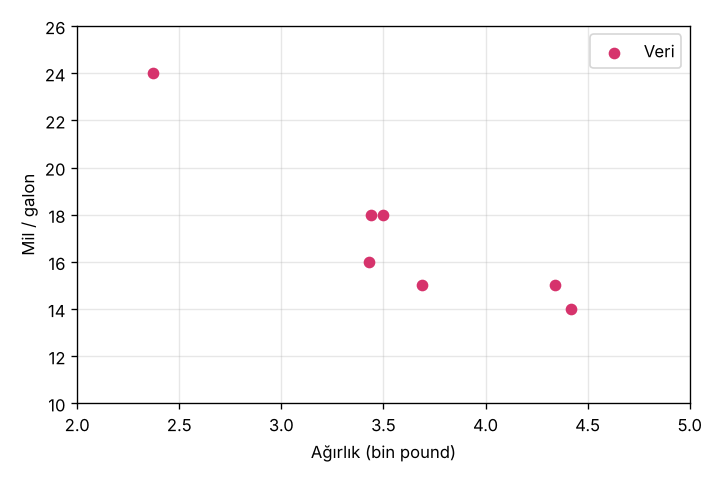
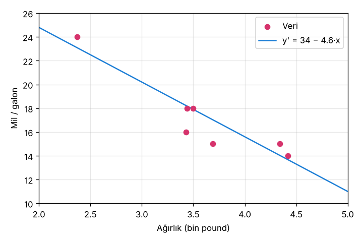
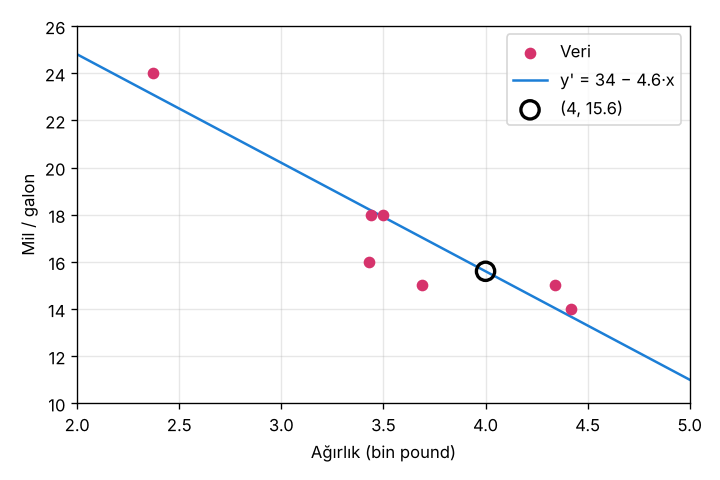

# 1.1 Doğrusal Regresyona Giriş

> Kaynak: [ML Crash Course — Doğrusal regresyon](https://developers.google.com/machine-learning/crash-course/linear-regression?hl=tr) · ⏱️ ~10 dk

## Nedir?
Doğrusal regresyon, değişkenler arasındaki ilişkiyi bulmak için kullanılan **istatistiksel bir tekniktir**. Makine öğreniminde **özellikler (features)** ile **etiket (label)** arasındaki ilişkiyi bulur.

- **Özellik (x):** Modele verilen girdi → ör. arabanın ağırlığı
- **Etiket (y):** Tahmin etmek istediğimiz değer → ör. yakıt verimliliği (mil/galon)

## Örnek veri: Ağırlık → Yakıt verimliliği

| Ağırlık — bin pound (özellik) | Mil/galon (etiket) |
|---|---|
| 3.50 | 18 |
| 3.69 | 15 |
| 3.44 | 18 |
| 3.43 | 16 |
| 4.34 | 15 |
| 4.42 | 14 |
| 2.37 | 24 |

> ⚠️ Türkçe çeviride "binlerce sterlin" yazıyor ama bu bir çeviri hatası: İngilizcedeki *pounds* burada para birimi değil, **ağırlık birimi (lb)**. 1 pound ≈ 0.45 kg.

**Şekil 1:** Araba ağırlaştıkça galon başına mil genellikle **düşer** → negatif ilişki.

Noktaların arasından **en iyi uyan doğruyu (best fit line)** geçirerek modelimizi oluştururuz:

## Doğrusal regresyon denklemi

### Cebirdeki hali
$$y = mx + b$$

| Terim | Anlamı |
|---|---|
| `y` | Mil/galon; tahmin etmek istediğimiz değer |
| `m` | Doğrunun eğimi |
| `x` | Girdi değerimiz (ağırlık) |
| `b` | y eksenini kestiği nokta |

### Makine öğrenimindeki hali
$$y' = b + w_1 x_1$$

| Terim | Anlamı | Cebirdeki karşılığı |
|---|---|---|
| `y'` | Tahmin edilen etiket (çıktı) | `y` |
| `b` | **Yanlılık / önyargı (bias)**. Bazen `w₀` diye yazılır | `b` (y-kesişimi) |
| `w₁` | Özelliğin **ağırlığı (weight)** | `m` (eğim) |
| `x₁` | **Özellik** (girdi) | `x` |

📌 `b` ve `w` modelin **parametreleridir** ve eğitim sırasında **hesaplanır**. Eğitimin amacı, en iyi modeli üreten ağırlığı ve yanlılığı bulmaktır. `x` değerleri ise verinin parçasıdır, değişmez.

> 💡 Türkçe çeviride *bias* için hem "önyargı" hem "yanlılık" geçiyor; ikisi de aynı şey.

### Sayısal örnek
Çizdiğimiz doğrudan: **yanlılık b = 34** (y-kesişimi), **ağırlık w₁ = −4.6** (eğim).

$$y' = 34 + (-4.6) \cdot x_1$$

4.000 pound'luk (x₁ = 4, yaklaşık 1.800 kg) bir araba için:

`y' = 34 − 4.6 × 4 = 15.6` mil/galon

## Birden fazla özellikli modeller

Daha karmaşık bir model, **her biri kendi ağırlığına sahip** birden fazla özellik kullanabilir. Beş özellikli model:

$$y' = b + w_1x_1 + w_2x_2 + w_3x_3 + w_4x_4 + w_5x_5$$

Yakıt verimliliği için örnek özellikler:
1. Ağırlık
2. Motor hacmi
3. İvme (0'dan 60'a çıkma süresi)
4. Silindir sayısı
5. Beygir gücü

Bu özellikler de etiketle doğrusal ilişki gösterir:
- **Motor hacmi ↑ → mil/galon ↓** (negatif ilişki, Şekil 6)
- **Hızlanma süresi ↑ → mil/galon ↑** (pozitif ilişki, Şekil 7): yavaş hızlanan araba genelde daha az yakar.

## ✅ Kendimi test
**S:** Eğitim sırasında denklemin hangi kısımları güncellenir?
**C:** Yalnızca **yanlılık (b)** ve **ağırlıklar (w)**. Özellikler ve tahminler güncellenmez.

## 🔑 Anahtar terimler
`bias` · `feature` · `label` · `linear regression` · `parameter` · `weight`

---
💻 İlgili kodlar:
- [`basit_regresyon.py`](../../kod/01-dogrusal-regresyon/basit_regresyon.py): en iyi doğruyu veriden hesaplar
- [`grafik.py`](../../kod/01-dogrusal-regresyon/grafik.py): bu nottaki grafikleri çizer
