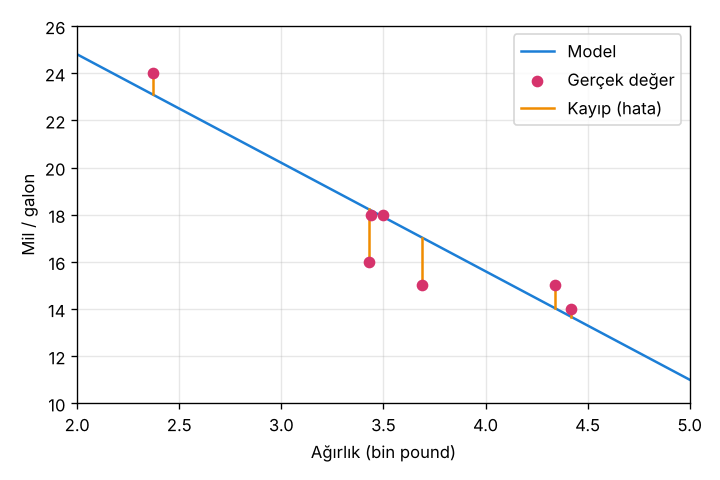
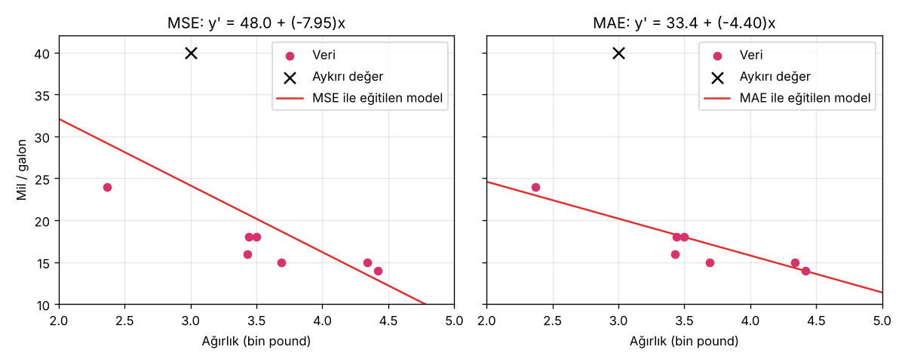

# 1.2 Kayıp (Loss)

> Kaynak: [ML Crash Course — Doğrusal regresyon: Kayıp](https://developers.google.com/machine-learning/crash-course/linear-regression/loss?hl=tr) · ⏱️ ~10 dk

## Nedir?
**Kayıp**, modelin tahminlerinin **ne kadar yanlış** olduğunu gösteren sayısal bir metriktir. Tahmin (`y'`) ile gerçek etiket (`y`) arasındaki **mesafeyi** ölçer.

🎯 **Eğitimin amacı:** kaybı mümkün olan en düşük değere indirmek.

**Şekil 8:** Turuncu çizgiler her noktanın kaybıdır: gerçek değer ile modelin tahmini arasındaki mesafe.

## Kayıp = mesafe, yön değil
Tahmin 2, gerçek değer 5 ise `2 − 5 = −3` çıkar, ama bizi ilgilendiren **3 birimlik mesafedir**. Bu yüzden tüm kayıp hesaplarında **işaret kaldırılır**:

1. Farkın **mutlak değeri**: `|y − y'|`
2. Farkın **karesi**: `(y − y')²`

## Kayıp türleri

| Kayıp | Tanım | Formül |
|---|---|---|
| **L1** | Mutlak farkların **toplamı** | $\sum \lvert y - y' \rvert$ |
| **MAE** (Ortalama Mutlak Hata) | L1'in N örnek üzerinden **ortalaması** | $\frac{1}{N}\sum \lvert y - y' \rvert$ |
| **L2** | Kare farkların **toplamı** | $\sum (y - y')^2$ |
| **MSE** (Ortalama Kare Hata) | L2'nin N örnek üzerinden **ortalaması** | $\frac{1}{N}\sum (y - y')^2$ |
| **RMSE** (Kök Ortalama Kare Hata) | MSE'nin **karekökü** | $\sqrt{\frac{1}{N}\sum (y - y')^2}$ |

### L1 ile L2 arasındaki fark: kare alma
- Fark **büyükse** (> 1), kare alma kaybı **büyütür** → büyük hatalar ağır cezalandırılır.
- Fark **küçükse** (< 1), kare alma kaybı **küçültür**.

### Hangisi daha kolay yorumlanır?
**MAE** ve **RMSE**, hatayı tahminle **aynı birimde** ölçer (ör. "ortalama 1 mil/galon yanılıyor"). MSE'nin birimi ise kare birimdir (mil/galon²).

> 📝 MAE **ortalama hatayı** gösterir. RMSE hataların **yayılımını** gösterir ve büyük hatalardan daha çok etkilenir. Bu yüzden ikisi arasında büyük fark olabilir.

Birden fazla örnek aynı anda işleniyorsa kayıpların **ortalamasını** almak önerilir (MAE, MSE, RMSE).

## Örnek hesaplama
Model: `y' = 34 − 4.6·x₁` (ağırlık w₁ = −4.6, yanlılık b = 34)

Ağırlığı **2.37** (2.370 lb ≈ 1.075 kg) olan araba için:

| Değer | Hesap | Sonuç |
|---|---|---|
| Tahmin | 34 + (−4.6 × 2.37) | **23.1** mil/galon |
| Gerçek değer | — | **24** mil/galon |
| L2 kaybı | (24 − 23.1)² | **0.81** |

> ⚠️ Türkçe çeviride birkaç hata var: "Yanlılık: 34 **ABD doları**" yazıyor, ama yanlılığın birimi para değil. Ayrıca değerler km/litreye çevrilmeye çalışılmış (9,8 / 10,2 km/l), oysa hesap mil/galon (23.1 / 24) üzerinden yapılıyor.

Tüm veri kümesi için (`kayip.py` çıktısı):

| L1 | MAE | L2 | MSE | RMSE |
|---|---|---|---|---|
| 6.72 | 0.96 | 10.94 | 1.56 | 1.25 |

## Kayıp seçimi ve aykırı değerler

**Aykırı değer (outlier):** İki anlamı var:
1. Normal aralığın dışındaki veri: ör. 8.000 lb'lik ya da 100 mpg yakan araba.
2. Modelin tahmininden çok uzak düşen nokta: ör. 3.000 lb'lik bir araba 40 mpg yakıyor, ama model ~20 mpg tahmin ediyor.

**MSE**, aykırı değeri çok ağır cezalandırır (hatanın karesi), bu yüzden modeli **aykırı değere doğru çeker**. **MAE** ise çekmez.

Aşağıda kendi verimize (3.0, 40) aykırı değerini ekleyip modeli iki farklı kayıpla eğittim:

| | Model | x = 3 için tahmin |
|---|---|---|
| **MSE** ile eğitilen | y' = 48.0 − 7.95x | 24.1 → aykırı değere doğru kaymış |
| **MAE** ile eğitilen | y' = 33.4 − 4.40x | 20.2 → orijinal modele çok yakın |

- **MSE:** Model aykırı değerlere daha **yakın**, diğer noktaların çoğundan daha **uzak**.
- **MAE:** Model aykırı değerlerden daha **uzak**, diğer noktaların çoğuna daha **yakın**.

💡 **Kural:** Aykırı değerler önemliyse ve model onları hesaba katmalıysa **MSE**, aykırı değerlerin modeli bozmasını istemiyorsan **MAE** kullan.

## ✅ Kendimi test
10 noktalı iki veri kümesi var, ikisinde de aynı model kullanılıyor:
- **Soldaki (A):** 6 nokta doğrunun tam üstünde, 2 nokta 1 birim yukarıda, 2 nokta 1 birim aşağıda.
- **Sağdaki (B):** 8 nokta doğrunun tam üstünde, 1 nokta 2 birim yukarıda, 1 nokta 2 birim aşağıda.

**S:** Çizilen veri noktaları üzerinde değerlendirildiğinde hangi modelin ortalama kare hatası (MSE) daha yüksektir? (Soldaki / Sağdaki)

| | MAE | MSE |
|---|---|---|
| A | (4 × 1) / 10 = **0.4** | (4 × 1²) / 10 = **0.4** |
| B | (2 × 2) / 10 = **0.4** | (2 × 2²) / 10 = **0.8** |

**C:** **Sağdaki model (B)**. İkisinin MAE'si aynı, ama B'deki hatalar daha büyük ve kare alma büyük hataları daha çok cezalandırıyor.

## 🔑 Anahtar terimler
`loss` · `L1 loss` · `L2 loss` · `MAE` · `MSE` · `RMSE` · `outlier` · `prediction`

---
💻 İlgili kod: [`kayip.py`](../../kod/01-dogrusal-regresyon/kayip.py): beş kayıp türünü hesaplar, tek nokta örneğini doğrular, MSE ile MAE'yi karşılaştırır ve grafikleri çizer.
