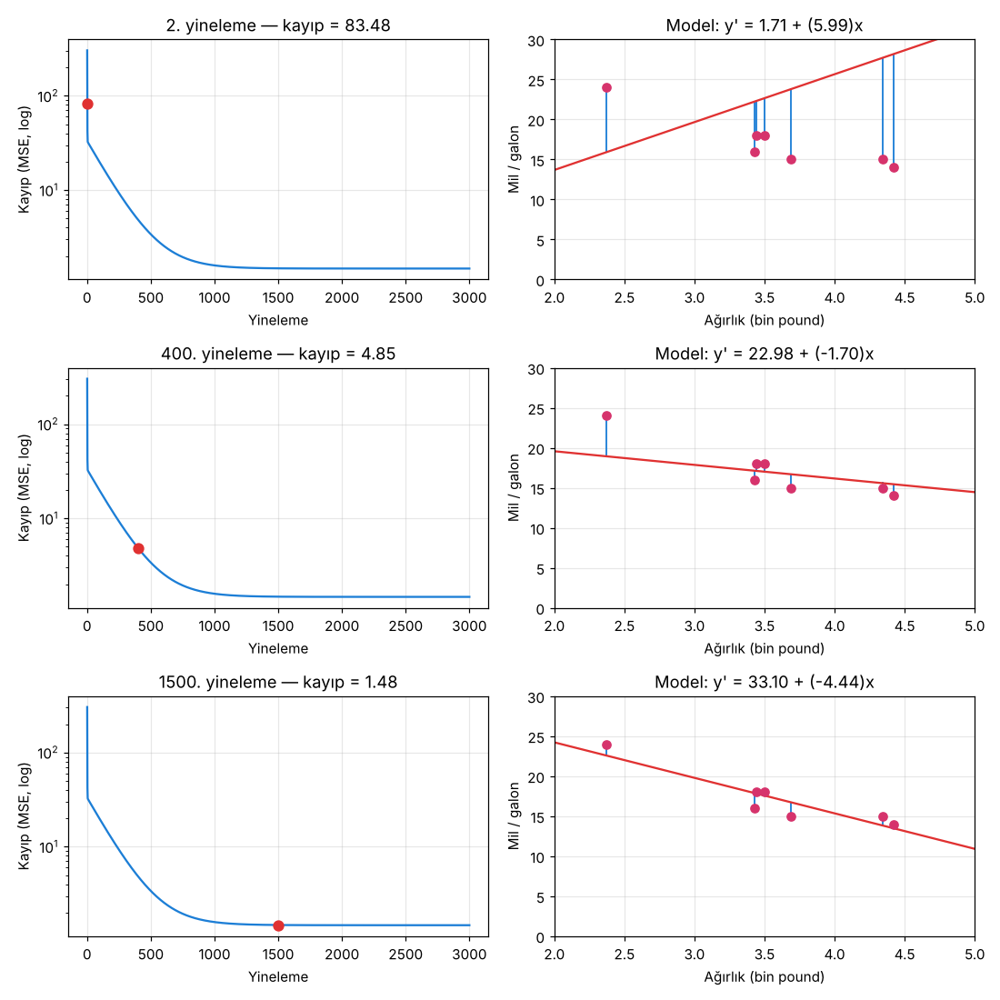
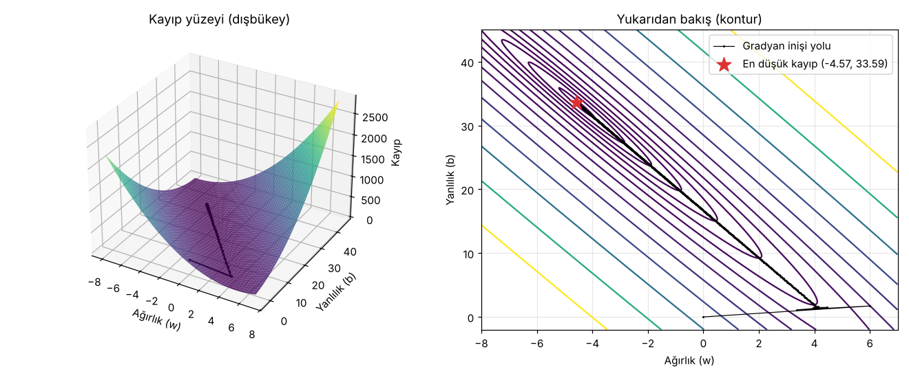

# 1.3 Gradyan İnişi (Gradient Descent)

> Kaynak: [ML Crash Course — Doğrusal regresyon: Gradyan inişi](https://developers.google.com/machine-learning/crash-course/linear-regression/gradient-descent?hl=tr) · ⏱️ ~10 dk

## Nedir?
**Gradyan inişi**, en düşük kayıplı modeli üreten **ağırlıkları (w)** ve **yanlılığı (b)** **yinelemeli** (adım adım) olarak bulan matematiksel bir tekniktir.

Model **sıfıra yakın** w ve b değerleriyle başlar, sonra şu döngüyü tekrarlar:

1. Mevcut w ve b ile **kaybı hesapla**.
2. Kaybı azaltmak için w ve b'yi **hangi yöne** hareket ettireceğini bul (eğim / gradyan).
3. w ve b'yi o yönde **küçük bir miktar** hareket ettir.
4. 1. adıma dön; kayıp artık azalmayana kadar devam et.

```
w ← w − öğrenme_oranı × ∂Kayıp/∂w
b ← b − öğrenme_oranı × ∂Kayıp/∂b
```

> 💡 "Küçük miktar" = **öğrenme oranı (learning rate)**. Bu derste 0.01 seçildi. Bir sonraki konu olan Hiperparametreler'de ayrıntılı işlenecek.

## Matematik: MSE'nin eğimi
Kayıp olarak MSE kullanılırsa:

$$\text{MSE} = \frac{1}{N}\sum (y' - y)^2, \quad y' = wx + b$$

Türevler (eğimler):

$$\frac{\partial \text{MSE}}{\partial w} = \frac{1}{N}\sum 2\,(y' - y)\,x \qquad \frac{\partial \text{MSE}}{\partial b} = \frac{1}{N}\sum 2\,(y' - y)$$

Eğim **pozitifse** değeri **azaltırız**, **negatifse** **artırırız**. Yani her zaman **eğimin tersi yönde** ilerleriz; "iniş" adı buradan geliyor.

## Somut örnek: ilk 6 yineleme
Başlangıç `w = 0`, `b = 0`, öğrenme oranı 0.01. Kodumla **birebir aynı** sonuçları aldım:

| Yineleme | Ağırlık | Yanlılık | Kayıp (MSE) |
|---|---|---|---|
| 1 | 0.00 | 0.00 | 303.71 |
| 2 | 1.20 | 0.34 | 170.84 |
| 3 | 2.05 | 0.59 | 103.17 |
| 4 | 2.66 | 0.78 | 68.70 |
| 5 | 3.09 | 0.91 | 51.13 |
| 6 | 3.40 | 1.01 | 42.17 |

Her adımda kayıp azalıyor ✅. İlk adımlarda ağırlık artıyor (pozitif), çünkü model önce y'yi büyütmeye çalışıyor; daha sonra negatif değerlere iniyor.

## Yakınsama (convergence)
Model **yakınsadığında** ek yinelemeler kaybı artık azaltmaz. Gradyan inişi kaybı **neredeyse** en aza indiren w ve b'yi bulmuştur.

- Yakınsamadan sonra eğitime devam edilirse kayıp en düşük değer etrafında **küçük dalgalanmalar** yapar.
- Yakınsadığından emin olmak için kayıp **sabitlenene kadar** eğitmek gerekir.

### Kayıp eğrisi (loss curve)
Yakınsamayı anlamanın yolu, **kayıp (y ekseni)** ile **yinelemeyi (x ekseni)** karşılaştıran grafiktir. Tipik eğri önce **keskin** düşer, sonra **yavaşça** düzleşir.

Kendi verimizle (öğrenme oranı 0.05) üç anlık görüntü. Sol: kayıp eğrisi, sağ: o andaki model. Mavi çizgiler kayıp; ne kadar uzunsa kayıp o kadar büyük:



| An | Durum |
|---|---|
| **2. yineleme** | Kayıp 83.48: model veriden çok uzak, eğimi bile ters |
| **400. yineleme** | Kayıp 4.85: veriden geçiyor ama açısı henüz doğru değil |
| **1500. yineleme** | Kayıp 1.48: yakınsadı, veriye iyi uyuyor |

## Dışbükey (convex) kayıp yüzeyi
Doğrusal modellerin kayıp fonksiyonu **her zaman dışbükeydir**: tek bir çukur, tek bir en düşük nokta vardır. Bu yüzden doğrusal regresyon yakınsadığında **en iyi** w ve b'yi bulduğumuzdan emin olabiliriz.

Gradyan inişi, **tepeden aşağı yuvarlanan bir top** gibi davranır: aşağı eğim kalmayınca durur.



Sol: 3B kayıp yüzeyi (x = ağırlık, y = yanlılık, z = kayıp). Sağ: yukarıdan bakış; siyah noktalar gradyan inişinin izlediği yol, yıldız en düşük nokta.

### Kendi verimizde sonuç
| Yöntem | w | b | MSE |
|---|---|---|---|
| Gradyan inişi (3000 yineleme) | −4.567 | 33.578 | 1.470 |
| `np.polyfit` (kesin çözüm) | −4.569 | 33.585 | 1.470 |

Gradyan inişi kesin çözüme **çok yaklaşıyor, ama tam aynı değeri bulmuyor**. Kursta da bu vurgulanıyor.

> 📝 Kurstaki 3B örnek **varsayımsal** bir veri kümesi kullanıyor (en düşük kayıp: w = −5.44, b = 35.94, kayıp = 5.54). Bu yüzden değerleri bizim 7 noktalı verimizden farklı.

> ⚠️ **En düşük kayıp genellikle 0'dan büyüktür.** Kaybın 0 olması modelin her noktaya tam uyduğu anlamına gelir. Bu genelde **aşırı uyumun (overfitting)** işaretidir; kursun ilerleyen bölümlerinde işlenecek.

## ✅ Kendimi test
**S:** Doğrusal regresyonda gradyan inişinin rolü nedir?
- ❌ Aykırı değerleri veri kümesinden kaldırır.
- ❌ Hangi kayıp türünün (L1 / L2) kullanılacağını belirler. (Kayıp seçimi gradyan inişinden **önce** yapılır.)
- ✅ **Kaybı en aza indiren en iyi ağırlıkları ve yanlılığı bulan yinelemeli bir süreçtir.**

## 🔑 Anahtar terimler
`gradient descent` · `iteration` · `learning rate` · `convergence` · `loss curve` · `convex function` · `overfitting`

---
💻 İlgili kod: [`gradyan_inisi.py`](../../kod/01-dogrusal-regresyon/gradyan_inisi.py): gradyan inişini sıfırdan yazar, ders tablosunu doğrular ve grafikleri çizer.
