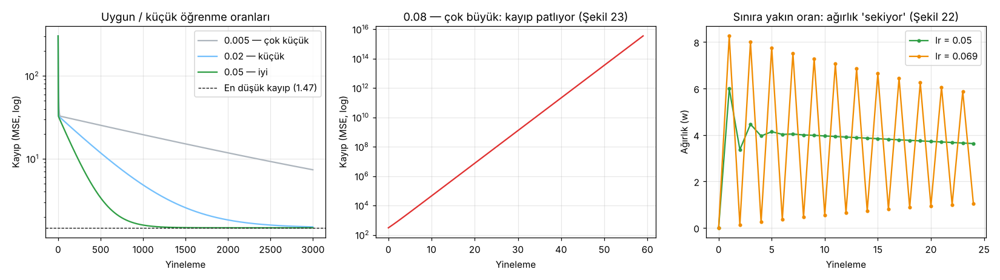
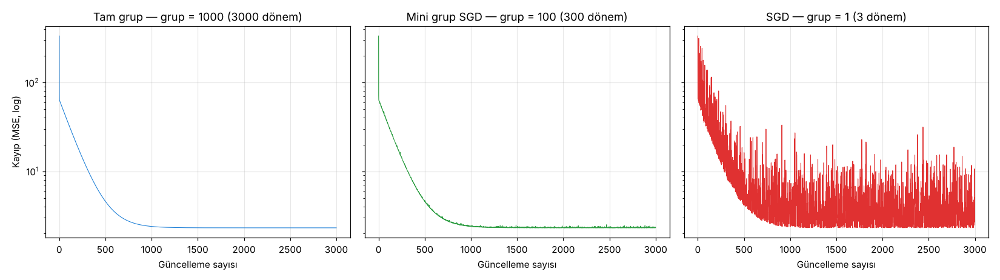

# 1.4 Hiperparametreler

> Kaynak: [ML Crash Course — Doğrusal regresyon: Hiperparametreler](https://developers.google.com/machine-learning/crash-course/linear-regression/hyperparameters?hl=tr) · ⏱️ ~10 dk

## Parametre mi, hiperparametre mi?

| | **Parametre** | **Hiperparametre** |
|---|---|---|
| Ne? | Modelin içindeki değerler | Eğitimi yöneten ayarlar |
| Örnek | Ağırlık (w), yanlılık (b) | Öğrenme oranı, grup boyutu, dönem sayısı |
| Kim belirler? | **Model**, eğitim sırasında hesaplar | **Biz**, eğitimden önce ayarlarız |

En sık kullanılan üç hiperparametre: **öğrenme oranı**, **grup boyutu (batch size)** ve **dönem sayısı (epochs)**.

---

## 1) Öğrenme oranı (learning rate)
Gradyan inişinin 3. adımındaki **"küçük miktar"**. Her adımda w ve b'nin ne kadar değişeceğini belirler:

```
yeni_parametre = eski_parametre − öğrenme_oranı × gradyan
```

- Adım boyutu **gradyanla orantılıdır**: eğim büyükse büyük adım, küçükse küçük adım atılır.
- Örnek: gradyan 2.5, öğrenme oranı 0.01 → parametre **0.025** değişir.

| Öğrenme oranı | Ne olur? |
|---|---|
| **Çok küçük** | Yakınsar ama **çok yavaş**; kayıp eğrisi neredeyse düz bir eğim gibi iner (Şekil 21) |
| **İdeal** | İlk yinelemelerde hızla düşer, sonra düzleşir (Şekil 20) |
| **Çok büyük** | **Asla yakınsamaz**: en iyi noktanın etrafında **seker** (Şekil 22) ya da kayıp **sürekli artar** (Şekil 23) |

### Kendi verimizle deney
7 arabalık veri, başlangıç w = b = 0. Kaybın en düşük değerin %1 yakınına gelmesi için gereken yineleme sayısı:

| Öğrenme oranı | Yakınsama |
|---|---|
| 0.005 | 13.710 yineleme 🐢 |
| 0.01 | 6.854 yineleme |
| 0.02 | 3.427 yineleme |
| 0.04 | 1.713 yineleme |
| 0.05 | 1.370 yineleme ✅ |
| 0.069 | 992 yineleme (ağırlık seke seke) |
| 0.08 | **Asla**: kayıp 60 adımda 10¹⁶'ya çıkıyor 💥 |

> 🔍 Bu veri için kritik sınır **≈ 0.0698**. Bunun altındaki her oran yakınsıyor, üstündekiler ıraksıyor. **0.04'ü iki katına (0.08) çıkarmak** eğitimi hızlandırmıyor, **tamamen bozuyor**. Test sorusundaki "öğrenme oranını iki katına çıkarmak eğitimi yavaşlatabilir" ifadesinin canlı örneği.



Sol: küçük ve iyi oranlar. Orta: çok büyük oranda kayıp patlıyor. Sağ: sınıra yakın oranda (0.069) ağırlık her adımda bir yukarı bir aşağı sekiyor.

---

## 2) Grup boyutu (batch size)
Model w ve b'yi **güncellemeden önce kaç örneğe baktığını** belirler.

Milyonlarca örnekli veride her adımda tüm veriyi işlemek (**tam grup / full batch**) pratik değildir. İki yaygın çözüm:

| Yöntem | Grup boyutu | Özellik |
|---|---|---|
| **Tam grup (full batch)** | N (tüm veri) | Pürüzsüz ama her adım pahalı |
| **SGD (stokastik gradyan inişi)** | **1** | Her adımda rastgele **tek** örnek. Ucuz ama **çok gürültülü** |
| **Mini grup SGD** | 1 < grup < N | İkisinin arası: rastgele seçilen örneklerin gradyanlarının **ortalaması** |

- **"Stokastik"** = örneklerin **rastgele** seçilmesi.
- **Gürültü** = kaybın bazen azalmak yerine **artması**. SGD'de bu yalnızca sonda değil, **tüm eğri boyunca** olur.
- Küçük gruplar SGD gibi, büyük gruplar tam grup gibi davranır.
- 💡 Gürültü her zaman kötü değildir: ileride modelin **daha iyi genelleme** yapmasına yardımcı olduğunu göreceğiz.

### Deney: 1.000 örnekli sentetik veri, eşit güncelleme sayısı (3.000)



| Yöntem | Grup | Son kayıp | Son 500 adımdaki dalgalanma (std) |
|---|---|---|---|
| Tam grup | 1000 | 2.305 | 0.0000 — pürüzsüz |
| Mini grup SGD | 100 | 2.326 | 0.02 — hafif titreşim |
| SGD | 1 | 2.491 | 2.54 — çok gürültülü |

> Üçü de aynı yere iniyor, fark **yolculukta**. Ama tam grup, bu 3.000 güncelleme için 3.000 kez tüm veriyi okudu; SGD toplam yalnızca 3 kez.

---

## 3) Dönem (epoch)
**1 dönem** = modelin eğitim kümesindeki **her örneği bir kez** işlemesi.

```
dönem başına yineleme = örnek sayısı / grup boyutu
```

Örnek: 1.000 örnek ve grup boyutu 100 ise → 1 dönem = **10 yineleme**.

- Eğitim genelde **çok sayıda dönem** sürer (her örnek birçok kez görülür).
- Dönem sayısı eğitimden önce ayarlanır; genellikle **deneyerek** bulunur.
- Daha çok dönem → genelde daha iyi model, ama daha uzun eğitim.

### Güncelleme sayısı: 1.000 örnek, 20 dönem
Kodla **birebir doğruladım**:

| Yöntem | Ne zaman güncellenir? | Dönem başına | **Toplam güncelleme** |
|---|---|---|---|
| Tam grup | Tüm örneklere baktıktan sonra | 1 | **20** |
| SGD | Her tek örnekten sonra | 1.000 | **20.000** |
| Mini grup (100) | Her 100'lük gruptan sonra | 10 | **200** |

> 📝 Aynı 20 dönemde, aynı öğrenme oranıyla (0.01), yalnızca SGD yakınsadı (MSE 2.31). 20 güncelleme tam grup için çok az kaldı (MSE 61.5). **Dönem sayısı tek başına yetmez; kaç güncelleme yapıldığı da önemli.**

---

## ✅ Kendimi test

**S1:** İdeal öğrenme oranı nedir? (1.0 / 0.01 / probleme bağlı)
**C:** **Probleme bağlı.** Her model ve veri kümesinin kendi ideal öğrenme oranı vardır. Bizim veride 0.05 iyi çalışıyor, 0.08 felaket.

**S2:** Mini grup SGD için en iyi grup boyutu nedir? (10 / 100 / duruma göre)
**C:** **Duruma göre değişir.** Veri kümesine ve elindeki işlem gücüne bağlıdır.

**S3:** Hangisi doğru?
- ✅ **Öğrenme oranını iki katına çıkarmak eğitimi yavaşlatabilir.** Oran çok yükselirse ağırlıklar seker ve yakınsama gecikir (ya da hiç olmaz).
- ❌ "Büyük gruplar aykırı değerli veriye uygun değildir." **Yanlış.** Büyük gruplar daha fazla gradyanın ortalamasını aldığı için aykırı değerlerin etkisini **azaltır**.

## 🔑 Anahtar terimler
`hyperparameter` · `parameter` · `learning rate` · `batch size` · `SGD` · `mini-batch SGD` · `epoch` · `noise` · `convergence`

---
💻 İlgili kod: [`hiperparametreler.py`](../../kod/01-dogrusal-regresyon/hiperparametreler.py): öğrenme oranı deneyleri, üç grup yöntemi ve güncelleme sayılarının doğrulaması.
