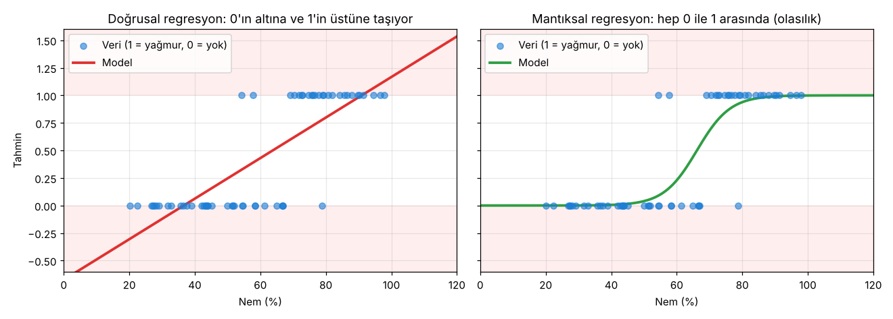

# 2.0 Mantıksal Regresyon: Modüle Giriş

> Kaynak: [ML Crash Course — Mantıksal regresyon](https://developers.google.com/machine-learning/crash-course/logistic-regression?hl=tr) · 🎥 [Tanıtım videosu](https://www.youtube.com/watch?v=72AHKztZN44) · ⏱️ Modül: ~35 dk

## Bu modülde ne öğreneceğim?
- Mantıksal regresyonun **nerelerde** kullanıldığını
- **Sigmoid fonksiyonu** ile **olasılığın** nasıl hesaplandığını
- **Doğrusal** ile **mantıksal** regresyonun farklarını
- Neden kare kaybı (MSE) yerine **log kaybı (log loss)** kullanıldığını
- Eğitimde **normalleştirmenin (regularization)** neden önemli olduğunu

> ⚠️ Çeviri notu: Türkçe sayfada "normalleştirme" yazıyor ama İngilizcesi **regularization**, yani aşırı uyumu engelleyen **düzenlileştirme**. Özellikleri ölçeklemek anlamındaki *normalization* ile karıştırmamak lazım.

Ön koşullar: Makine öğrenimine giriş ve [Doğrusal regresyon](../01-dogrusal-regresyon/) modülü ✅

## Neden yeni bir model?
Doğrusal regresyon **sürekli sayılar** tahmin ediyordu: yakıt verimliliği 15.6 mil/galon, taksi ücreti 23.4 $…

Peki şu sorular?
- "Bugün **yağmur yağacak mı**?"
- "Bu e-posta **spam mi**?"

Bunların cevabı bir sayı değil, **evet / hayır**. Mantıksal regresyon bunun için tasarlanmış: Bir sonucun **olasılığını** (0 ile 1 arası) tahmin eder. Ör. "Yağmur yağma olasılığı %82".

| | Doğrusal regresyon | Mantıksal regresyon |
|---|---|---|
| Ne tahmin eder? | Sürekli bir sayı | Bir olayın **olasılığı** |
| Çıktı aralığı | −∞ … +∞ | **0 … 1** |
| Örnek | Yakıt verimliliği, ücret | Spam mi? Yağmur yağacak mı? |
| Kayıp | MSE | Log kaybı (sonraki derslerde) |

## Doğrusal regresyon neden yetmiyor? (kendi denemem)
Nem oranından yağmur yağıp yağmayacağını (1 / 0) tahmin etmeye çalıştım:

| Nem | Doğrusal regresyon | Mantıksal regresyon |
|---|---|---|
| %10 | **−0.49** ❌ | 0.00 |
| %65 | 0.52 | 0.44 |
| %120 | **1.54** ❌ | 1.00 |

Doğrusal regresyon **−0.49** ya da **1.54** gibi olasılık olamayacak değerler üretiyor. Mantıksal regresyonun S şeklindeki eğrisi (sigmoid) ise her zaman 0 ile 1 arasında kalıyor.

> 💡 Sigmoid, log kaybı ve normalleştirme modülün sonraki derslerinde ayrıntılı işlenecek; buradaki kod sadece bir ön izleme.

## 🔑 Anahtar terimler
`logistic regression` · `probability` · `sigmoid function` · `log loss` · `regularization`

---
💻 İlgili kod: [`neden_mantiksal.py`](../../kod/02-mantiksal-regresyon/neden_mantiksal.py)
