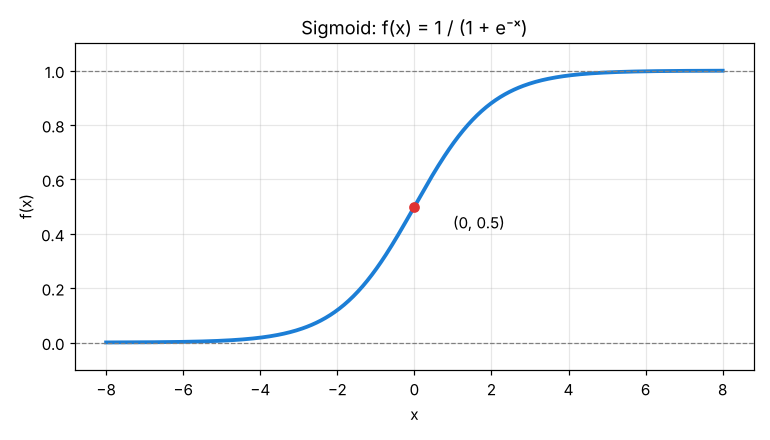
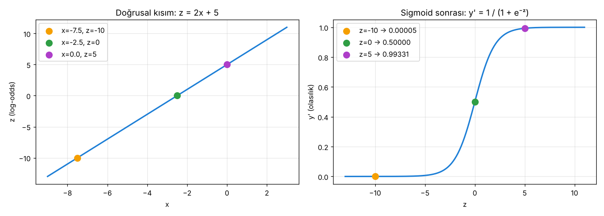

# 2.1 Sigmoid ile Olasılık Hesaplama

> Kaynak: [ML Crash Course — Mantıksal regresyon: Sigmoid işleviyle olasılığı hesaplama](https://developers.google.com/machine-learning/crash-course/logistic-regression/sigmoid-function?hl=tr)

## Olasılık çıktısı nasıl kullanılır?
Mantıksal regresyon **olasılık** hesaplamanın çok verimli bir yoludur. Çıkan olasılık iki şekilde kullanılabilir:

1. **Olduğu gibi:** Spam modeli **0.932** veriyorsa → e-postanın spam olma olasılığı **%93.2**.
2. **İkili kategoriye dönüştürülerek:** Spam / Spam değil, Doğru / Yanlış.

Bu modül **1. kullanıma** odaklanıyor; 2. kullanım *Sınıflandırma* modülünde gelecek.

## Sigmoid fonksiyonu
Çıktıyı her zaman 0 ile 1 arasında tutan fonksiyon ailesine **lojistik fonksiyonlar** denir. En bilineni **standart lojistik fonksiyon**, yani **sigmoid** ("S şeklinde"):

$$f(x) = \frac{1}{1 + e^{-x}}$$

| Sembol | Anlamı |
|---|---|
| `f(x)` | Sigmoid'in çıktısı |
| `e` | Euler sayısı ≈ 2.71828 |
| `x` | Sigmoid'in girdisi |

- x → +∞ iken çıktı **1'e yaklaşır ama asla 1 olmaz**.
- x → −∞ iken çıktı **0'a yaklaşır ama asla 0 olmaz**.
- x = 0 iken çıktı tam **0.5**.

### Sigmoid tablosu (kodla üretildi)
| Girdi | −7 | −6 | −5 | −4 | −3 | −2 | −1 | 0 | 1 | 2 | 3 | 4 | 5 | 6 | 7 |
|---|---|---|---|---|---|---|---|---|---|---|---|---|---|---|---|
| Çıktı | 0.001 | 0.002 | 0.007 | 0.018 | 0.047 | 0.119 | 0.269 | 0.500 | 0.731 | 0.881 | 0.953 | 0.982 | 0.993 | 0.998 | 0.999 |

Çıktı ±4'ten sonra 0'a ve 1'e çok hızlı yaklaşıyor.

> 📝 Kurstaki tabloda 3 için **0.952**, 6 için **0.997** yazıyor; ben 0.953 ve 0.998 buldum. Gerçek değerler 0.9526 ve 0.9975. Kurs sayıları **yuvarlamak yerine kesmiş**.

## Doğrusal çıktıyı sigmoid'e sokmak
Mantıksal regresyon **iki adımdır**:

**1) Doğrusal kısım** (doğrusal regresyondaki denklemin aynısı):

$$z = b + w_1x_1 + w_2x_2 + \dots + w_Nx_N$$

`z`'ye **log-odds** denir. `b` yanlılık, `w` öğrenilen ağırlıklar, `x` örneğin özellik değerleri.

**2) Sigmoid:** z'yi 0 ile 1 arasına sıkıştır:

$$y' = \frac{1}{1 + e^{-z}}$$

### Neden "log-odds"?
Sigmoid denklemi z için çözülürse:

$$z = \ln\left(\frac{y}{1 - y}\right)$$

Yani z, iki sonucun olasılık oranının (**odds**: y / (1 − y)) **doğal logaritmasıdır**. Kodla doğruladım: z = 1 → y = 0.7311 → ln(0.7311 / 0.2689) = **1.0000** ✅

### Şekil 2: z = 2x + 5

| x | z = 2x + 5 | y' = sigmoid(z) |
|---|---|---|
| −7.5 | −10 | 0.0000454 |
| −2.5 | 0 | 0.5 |
| 0 | 5 | 0.9933 |

z çok büyük ya da çok küçük olabilir, ama y' **her zaman 0 ile 1 arasında** (uçlar hariç) kalır. Sigmoid düz çizgiyi S şekline büker.

> 📝 Kurs z = −10 için 0.00004 diyor; gerçek değer 0.0000454 (yine kesilmiş).

## ✅ Kendimi test
Üç özellikli bir model: **b = 1**, **w₁ = 2**, **w₂ = −1**, **w₃ = 5**
Girdiler: **x₁ = 0**, **x₂ = 10**, **x₃ = 2**

**S1:** z (log-odds) kaçtır?
$$z = 1 + (2)(0) + (-1)(10) + (5)(2) = 1 + 0 - 10 + 10 = \mathbf{1}$$

**S2:** Mantıksal regresyon tahmini nedir?
$$y' = \frac{1}{1 + e^{-1}} = \mathbf{0.731}$$

→ Bu örneğin pozitif sınıfta olma olasılığı **%73.1**.

## 🔑 Anahtar terimler
`sigmoid function` · `logistic function` · `log-odds` · `odds` · `probability`

---
💻 İlgili kod: [`sigmoid.py`](../../kod/02-mantiksal-regresyon/sigmoid.py): tabloyu, log-odds dönüşümünü, Şekil 2'yi ve alıştırmayı hesaplar.
