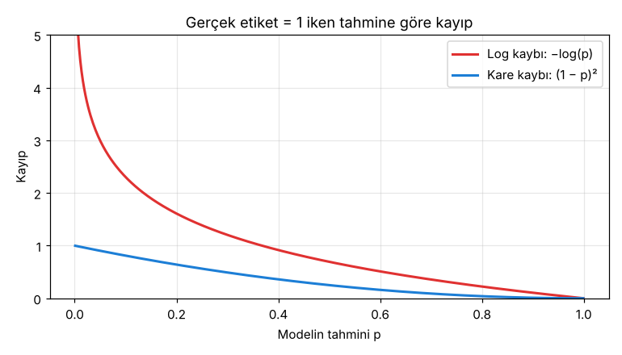
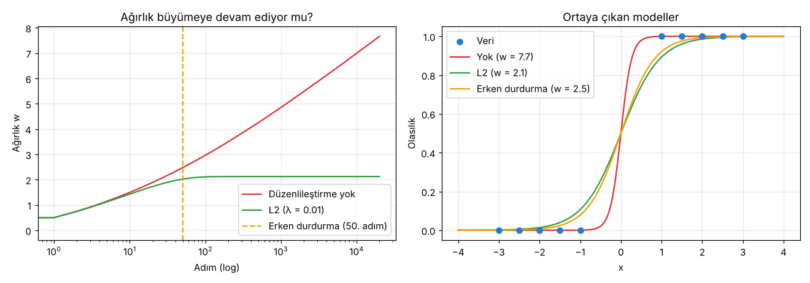

# 2.2 Log Kaybı ve Düzenlileştirme

> Kaynak: [ML Crash Course — Mantıksal regresyon: Kayıp ve normalleştirme](https://developers.google.com/machine-learning/crash-course/logistic-regression/loss-regularization?hl=tr)

Mantıksal regresyon, doğrusal regresyonla **aynı yöntemle** (gradyan inişi) eğitilir. İki temel fark var:

1. Kayıp olarak kare kaybı (L2) yerine **log kaybı (Log Loss)** kullanılır.
2. Aşırı uyumu önlemek için **düzenlileştirme (regularization)** kritik öneme sahiptir.

> ⚠️ Çeviri notları: Sayfa başlığında "normalleştirme", ara başlıkta **"Günlük Kaybı"** yazıyor. İkisi de çeviri hatası: doğrusu **düzenlileştirme** (*regularization*) ve **log kaybı** (*log loss*; "log" burada logaritma, günlük değil).

## Neden kare kaybı olmaz?
Kare kaybı, **değişim hızı sabit** olan doğrusal modellerde iyi çalışır. Ör. `y' = 1 + 3x` modelinde x her 1 arttığında y' her zaman 3 artar.

Sigmoid ise **S şeklindedir**, değişim hızı sabit değil:
- z, 0'a yakınken küçük değişimler y'yi **çok** değiştirir.
- z büyük (ya da çok negatif) iken y' 1'e (ya da 0'a) yapışır ve değişimler **minicik** kalır.

| Girdi (z) | Sigmoid çıktısı | Gerekli hassasiyet (basamak) | 1 − çıktı |
|---|---|---|---|
| 5 | 0.993 | 3 | 6.7 × 10⁻³ |
| 6 | 0.997 | 3 | 2.5 × 10⁻³ |
| 7 | 0.999 | 3 | 9.1 × 10⁻⁴ |
| 8 | 0.9997 | 4 | 3.4 × 10⁻⁴ |
| 9 | 0.9999 | 4 | 1.2 × 10⁻⁴ |
| 10 | 0.99998 | 5 | 4.5 × 10⁻⁵ |

Kare kaybı kullansaydık, çıktı 0 ve 1'e yaklaştıkça farkları yakalamak için **giderek daha fazla basamak**, yani daha fazla bellek gerekirdi.

## Log kaybı (Log Loss)
Log kaybı, tahminle gerçek arasındaki mesafeyi değil, **değişimin büyüklüğünün logaritmasını** ölçer:

$$\text{Log Loss} = \frac{1}{N}\sum_{i=1}^{N} -y_i \log(y'_i) - (1 - y_i)\log(1 - y'_i)$$

| Sembol | Anlamı |
|---|---|
| `N` | Veri kümesindeki etiketli örnek sayısı |
| `i` | Örneğin sırası (ör. `i = 3` üçüncü örnek) |
| `yᵢ` | i. örneğin etiketi: **0 veya 1** |
| `y'ᵢ` | Modelin i. örnek için tahmini: **0 ile 1 arası** |

### Formül nasıl çalışıyor?
Etiket yalnızca 0 ya da 1 olduğu için toplamdaki iki terimden **yalnızca biri** devreye girer:
- **y = 1** ise → kayıp = **−log(y')**: y' 1'e yaklaştıkça kayıp 0'a iner.
- **y = 0** ise → kayıp = **−log(1 − y')**: y' 0'a yaklaştıkça kayıp 0'a iner.

### Kare kaybıyla karşılaştırma (gerçek etiket = 1)
| Tahmin p | Kare kaybı (1 − p)² | Log kaybı −log(p) |
|---|---|---|
| 0.99 | 0.000 | 0.010 |
| 0.9 | 0.010 | 0.105 |
| 0.5 | 0.250 | 0.693 |
| 0.1 | 0.810 | 2.303 |
| 0.01 | 0.980 | **4.605** |

Kare kaybı en fazla 1 olabiliyor. Log kaybı ise **kendinden emin ama yanlış** tahminleri (gerçek 1 iken p = 0.01) çok ağır cezalandırıyor ve p → 0 iken sonsuza gidiyor.

### Toplam değil ortalama
Formül **ortalama** log kaybını hesaplıyor (1/N). Pratikte ortalama tercih edilir, çünkü **grup boyutu ile öğrenme oranının ayarlanmasını birbirinden bağımsız** hale getirir. Toplam kullanılsaydı grup boyutunu büyütmek, gradyanı ve dolayısıyla etkin öğrenme oranını da büyütürdü.

## Mantıksal regresyonda düzenlileştirme
**Düzenlileştirme**, eğitim sırasında **model karmaşıklığını cezalandıran** bir mekanizmadır.

**Neden kritik?** Sigmoid 0 ve 1'e **asla ulaşmaz** (asimptotik). Düzenlileştirme olmazsa model, özellikle çok sayıda özellik varken, kaybı 0'a indirmek için ağırlıkları **sonsuza kadar büyütmeye** devam eder. Bu da aşırı uyuma (overfitting) yol açar.

İki yaygın strateji:
1. **L2 düzenlileştirme:** Büyük ağırlıkları kayba bir ceza ekleyerek frenler (ayrıntısı ileride).
2. **Erken durdurma (early stopping):** Kayıp hâlâ azalırken eğitimi durdurmak, yani eğitim adımı sayısını sınırlamak.

### Deney: tamamen ayrılabilir veri
x < 0 olan bütün örnekler 0, x > 0 olan bütün örnekler 1 olacak şekilde 10 nokta ürettim:

| Adım | Düzenlileştirme yok: w | Kayıp | L2 (λ = 0.01): w |
|---|---|---|---|
| 10 | 1.44 | 0.083 | 1.38 |
| 100 | 2.96 | 0.013 | 2.11 |
| 1.000 | 4.86 | 0.0017 | 2.12 |
| 10.000 | 7.00 | 0.0002 | 2.12 |
| 20.000 | **7.66** ↗ | 0.0001 | **2.12** ✋ |

- **Düzenlileştirme yok:** Ağırlık durmadan büyüyor, kayıp 0'a yaklaşıyor ama hiç ulaşmıyor. Model bir **basamak fonksiyonuna** dönüşüyor ve aşırı kendinden emin hale geliyor.
- **L2:** Ağırlık ~2.12'de sabitleniyor.
- **Erken durdurma (50. adım):** w = 2.46'da kalıyor; L2'ye benzer, yumuşak bir eğri.

## 🔑 Anahtar terimler
`log loss` · `squared loss` · `regularization` · `L2 regularization` · `early stopping` · `overfitting` · `asymptote`

---
💻 İlgili kod: [`log_kaybi.py`](../../kod/02-mantiksal-regresyon/log_kaybi.py): hassasiyet tablosu, log kaybı ve kare kaybı karşılaştırması, düzenlileştirme deneyi.
