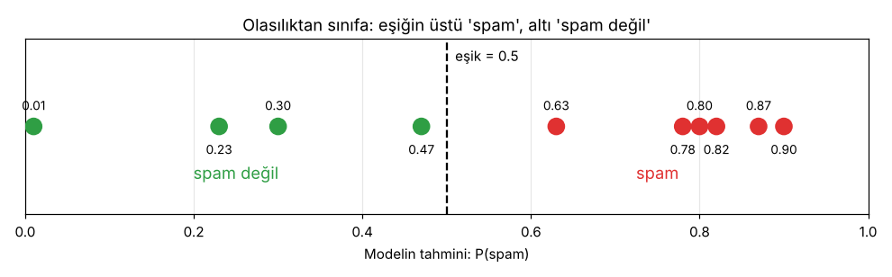

# 3.0 Sınıflandırma: Modüle Giriş

> Kaynak: [ML Crash Course — Sınıflandırma](https://developers.google.com/machine-learning/crash-course/classification?hl=tr) · ⏱️ Modül: ~70 dk

## Bu modülde ne öğreneceğim?
- İkili sınıflandırma modeli için uygun bir **eşik (threshold)** belirlemeyi
- Modeli değerlendirmek için doğru **metrikleri** hesaplayıp seçmeyi
- **ROC** eğrisini ve **AUC** değerini yorumlamayı
- Son olarak **çok sınıflı sınıflandırmayı**

Ön koşullar: Makine öğrenimine giriş, [Doğrusal regresyon](../01-dogrusal-regresyon/) ✅, [Mantıksal regresyon](../02-mantiksal-regresyon/) ✅

## Olasılıktan kategoriye
Mantıksal regresyon modülünde sigmoid ile bir **olasılık** tahmin ettik: "Bu e-postanın spam olma olasılığı **%75**."

Peki amacımız olasılık değil de bir **kategori** ise? "Bu e-posta **spam** mi, **spam değil** mi?"

**Sınıflandırma (classification):** Bir örneğin hangi **sınıfa** (kategoriye) ait olduğunu tahmin etme görevi.

| Terim | Anlamı | Örnek |
|---|---|---|
| **Sınıf (class)** | Tahmin edilebilecek kategorilerden biri | "spam", "spam değil" |
| **İkili sınıflandırma** | İki sınıftan birini tahmin eder | Spam mı? Hasta mı? |
| **Çok sınıflı sınıflandırma** | İkiden fazla sınıftan birini tahmin eder | Bu fotoğraf kedi mi, köpek mi, kuş mu? |

## Temel fikir: eşik
Mantıksal regresyon modelini ikili sınıflandırıcıya dönüştürmenin yolu bir **eşik** seçmek:

```
P(spam) ≥ eşik  →  "spam"
P(spam) < eşik  →  "spam değil"
```



Aynı 10 olasılık için eşiği değiştirince sonuç da değişiyor:

| Eşik | Kaç e-posta "spam" sayılıyor? |
|---|---|
| 0.3 | 8 / 10 |
| 0.5 | 6 / 10 |
| 0.8 | 4 / 10 |

> 💡 Yani eşik, modelin kendisini değiştirmeden **ne kadar temkinli** davranacağını belirliyor. Hangi eşiğin "doğru" olduğu ve bunun nasıl ölçüleceği modülün sonraki derslerinde.

## 🔑 Anahtar terimler
`classification` · `class` · `binary classification` · `multi-class classification` · `sigmoid function` · `threshold`

---
💻 İlgili kod: [`olasiliktan_sinifa.py`](../../kod/03-siniflandirma/olasiliktan_sinifa.py)
