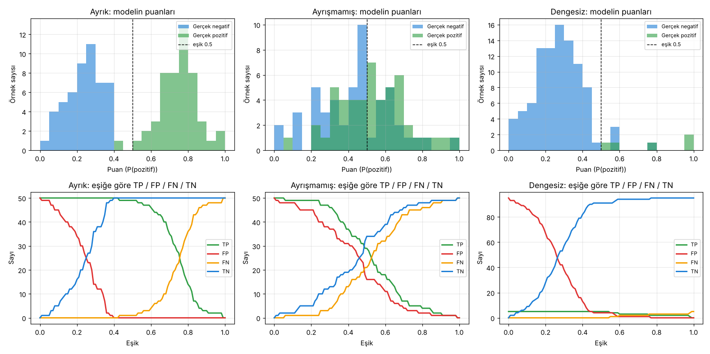

# 3.1 Eşikler ve Karışıklık Matrisi

> Kaynak: [ML Crash Course — Eşikler ve karışıklık matrisi](https://developers.google.com/machine-learning/crash-course/classification/thresholding?hl=tr)

## Sınıflandırma eşiği
Spam modeli 0 ile 1 arasında bir **olasılık** verir (0.75 → %75 spam). E-posta uygulamasında kullanmak için bunu **iki kategoriden birine** çevirmek gerekir. Bunun için bir **sınıflandırma eşiği (classification threshold)** seçilir:

| Durum | Atanan sınıf |
|---|---|
| Olasılık **eşiğin üstünde** | **Pozitif sınıf**: test ettiğimiz sınıf (spam) |
| Olasılık **eşiğin altında** | **Negatif sınıf**: alternatif sınıf (spam değil) |

**Örnek:** İki e-posta 0.99 ve 0.51 puan almış olsun.
- Eşik **0.5** → ikisi de spam
- Eşik **0.95** → yalnızca 0.99 olan spam

### Puan eşiğe tam eşitse?
Kullanılan araca bağlı. **Keras** bu durumda **negatif sınıfı** tahmin eder (yani pozitif için `puan > eşik` gerekir). Başka araçlar farklı davranabilir.

### 0.5 her zaman iyi bir eşik mi? Hayır.
- **Sınıflar dengesizse:** Ör. e-postaların yalnızca %0.01'i spam.
- **Hataların maliyeti farklıysa:** Ör. önemli bir e-postanın spam klasörüne düşmesi, bir spam'in gelen kutusuna girmesinden daha kötü.

Bu durumlarda %50'nin üstündeki her şeyi spam saymak istenmeyen sonuçlar doğurur.

## Karışıklık matrisi (confusion matrix)
Olasılık puanı **gerçek değer (ground truth)** değildir. İkili sınıflandırıcının her tahmini için **dört olası sonuç** vardır:

| | **Gerçekte pozitif** (spam) | **Gerçekte negatif** (spam değil) |
|---|---|---|
| **Tahmin: pozitif** | ✅ **Doğru pozitif (TP)**: Spam doğru yakalandı → spam klasörüne gitti | ❌ **Yanlış pozitif (FP)**: Normal e-posta spam sanıldı → spam klasörüne gitti |
| **Tahmin: negatif** | ❌ **Yanlış negatif (FN)**: Spam kaçırıldı → gelen kutusuna girdi | ✅ **Doğru negatif (TN)**: Normal e-posta doğru tanındı → gelen kutusuna gitti |

- **Satır toplamları** = modelin tahminleri: tüm tahmini pozitifler **TP + FP**, tüm tahmini negatifler **FN + TN**
- **Sütun toplamları** = gerçek durum: tüm gerçek pozitifler **TP + FN**, tüm gerçek negatifler **FP + TN**

> ⚠️ **Çeviri notları:**
> - Türkçe sayfada FN, "Spam olarak sınıflandırılan ancak spam olmayan bir e-posta" diye tanımlanmış. Bu **yanlış**, o FP'nin tanımı. Doğrusu: **spam olduğu hâlde spam değil diye sınıflandırılan e-posta**, yani filtreden kaçan spam.
> - Sayfada "gerçek pozitif" hem *actual positive* (gerçekte pozitif olan) hem de *true positive* (doğru pozitif, TP) için kullanılıyor. Karışmaması için bu notta **TP = doğru pozitif**, **"gerçekte pozitif" = etiketi pozitif olan** diye ayırdım.
> - Anahtar terimlerdeki "Gerçek doğru" = *ground truth* (gerçek etiket).

### Dengesiz veri kümesi (class-imbalanced dataset)
Gerçek pozitiflerin toplamı gerçek negatiflerinkine **yakın değilse** veri kümesi dengesizdir. Örnek: binlerce bulut fotoğrafı arasında nadir bir türün (volkanik bulut) yalnızca birkaç kez görünmesi.

## Eşik TP, FP, FN, TN'yi nasıl etkiler?
Sayfadaki widget'a benzer üç oyuncak veri kümesi ürettim. Üst satır: modelin puanları, gerçek sınıfa göre renkli. Alt satır: eşik 0'dan 1'e giderken dört sayının değişimi.

| Veri kümesi | Durum |
|---|---|
| **Ayrık** | Pozitiflerin çoğu negatiflerden yüksek puan alıyor. 0.4–0.5 civarında neredeyse hatasız bir eşik var. |
| **Ayrışmamış** | Puanlar iç içe. Hangi eşiği seçersen seç, ya FP ya FN yüksek kalıyor. |
| **Dengesiz** | Yalnızca 5 pozitif var. Eşik 0.5'te TP = 5, FP = 4, TN = 91: model "çoğu doğru" görünüyor ama bu sayı yanıltıcı (sonraki derste: doğruluk metriği). |

Kodla örnek matris (ayrık veri, eşik 0.5):

| | Gerçekte pozitif | Gerçekte negatif | |
|---|---|---|---|
| Tahmin pozitif | TP = 49 | FP = 0 | 49 |
| Tahmin negatif | FN = 1 | TN = 50 | 51 |
| | 50 | 50 | |

Aynı veride eşik **0.95** yapılınca: TP = 2, FN = 48. Model neredeyse hiçbir şeyi pozitif demiyor.

## ✅ Kendimi test
**S1:** Kimlik avı / kötü amaçlı yazılım modeli: zararlı site = 1 (pozitif), zararsız site = 0. Model **meşru bir siteyi** yanlışlıkla **kötü amaçlı** diye sınıflandırıyor. Bu nedir?
**C:** **Yanlış pozitif (FP).** Gerçekte negatif, tahmin pozitif.

**S2:** Eşik yükselince yanlış pozitifler ve doğru pozitifler ne olur?
**C:** **İkisi de azalır.** Daha az örnek pozitif sayılır. Kodda (ayrışmamış veri, eşik 0.3 → 0.7): TP 46 → 7, FP 37 → 4.

**S3:** Eşik yükselince yanlış negatifler ve doğru negatifler ne olur?
**C:** **İkisi de artar.** Daha çok örnek negatif sayılır. Kodda: FN 4 → 43, TN 13 → 46.

> 💡 Kural: Eşik ↑ → pozitif tahminler (TP, FP) ↓, negatif tahminler (TN, FN) ↑. Eşik ↓ → tam tersi.

## 🔑 Anahtar terimler
`classification threshold` · `positive class` · `negative class` · `confusion matrix` · `true positive (TP)` · `false positive (FP)` · `false negative (FN)` · `true negative (TN)` · `ground truth` · `class-imbalanced dataset`

---
💻 İlgili kod: [`karisiklik_matrisi.py`](../../kod/03-siniflandirma/karisiklik_matrisi.py)
