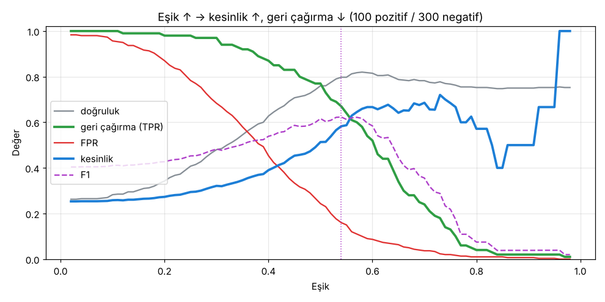

# 3.2 Doğruluk, Geri Çağırma, Kesinlik ve İlgili Metrikler

> Kaynak: [ML Crash Course — Doğruluk, geri çağırma, hassasiyet ve ilgili metrikler](https://developers.google.com/machine-learning/crash-course/classification/accuracy-precision-recall?hl=tr)

Karışıklık matrisindeki TP, FP, FN, TN değerlerinden modeli değerlendiren metrikler hesaplanır. Hangisinin anlamlı olduğu **modele, göreve, hataların maliyetine ve verinin dengeli olup olmamasına** bağlıdır.

📌 Buradaki bütün metrikler **tek bir sabit eşikte** hesaplanır; eşik değişince metrikler de değişir. Pratikte eşik, genellikle bu metriklerden **birini optimize edecek** şekilde ayarlanır.

> ⚠️ **Terim karmaşası:** Türkçe sayfada *recall* için hem "geri çağırma" hem "hatırlama", *precision* için hem "**hassasiyet**" hem "kesinlik" kullanılıyor. Bu notta **geri çağırma = recall**, **kesinlik = precision** diye sabitledim. "Hassasiyet" Türkçede genelde *sensitivity* (yani recall!) için de kullanıldığından kafa karıştırıcı. Ayrıca alıştırmada TP/TN/FP/FN için "DO/GD/YDO/YD" gibi kısaltmalar geçiyor; anlamları aynı.

## Özet tablo
| Metrik | Formül | Soru | Mükemmel model |
|---|---|---|---|
| **Doğruluk** (accuracy) | (TP + TN) / (TP + TN + FP + FN) | Tüm tahminlerin ne kadarı doğru? | 1.0 |
| **Geri çağırma / TPR** (recall) | TP / (TP + FN) | Gerçek pozitiflerin ne kadarını yakaladık? | 1.0 |
| **Yanlış pozitif oranı / FPR** | FP / (FP + TN) | Gerçek negatiflerin ne kadarına yanlış alarm verdik? | 0.0 |
| **Kesinlik** (precision) | TP / (TP + FP) | "Pozitif" dediklerimizin ne kadarı gerçekten pozitif? | 1.0 |

> 💡 Ezber hilesi: Paydaya bak.
> - **Geri çağırma** ve **FPR** → paydada **gerçek durum** (sütun toplamı: TP + FN veya FP + TN)
> - **Kesinlik** → paydada **modelin tahmini** (satır toplamı: TP + FP)

## Doğruluk (accuracy)
Pozitif ya da negatif, **doğru olan tüm sınıflandırmaların oranı**. Spam örneğinde: doğru sınıflandırılan tüm e-postaların oranı.

- Dört sonucu da içerdiği için **dengeli** veride modelin kalitesini kabaca gösterir; genel modeller için varsayılan metriktir.
- ❌ **Dengesiz veride yanıltıcıdır.** Pozitiflerin %1 olduğu bir veride **her zaman negatif** diyen işe yaramaz bir model **%99 doğruluk** alır.

Kodla gösterdim: 1.000 e-posta, 10 spam, model hep "spam değil" diyor:

| Doğruluk | Geri çağırma | FPR | Kesinlik |
|---|---|---|---|
| **0.99** 🎉 | **0.00** 💀 | 0.00 | NaN |

> 📝 ML'de doğruluk, kesinlik ve geri çağırmanın günlük dildeki anlamlarından farklı, **matematiksel** tanımları var.

## Geri çağırma (recall) / Doğru pozitif oranı (TPR)
**Gerçekten pozitif olanların ne kadarının doğru yakalandığı.** Diğer adı: **algılama olasılığı (probability of detection)**.

- Spam örneğinde: "Spam e-postaların **ne kadarını** yakalıyoruz?"
- FN'ler, negatif sanılmış gerçek pozitiflerdir; bu yüzden paydada yer alırlar.
- **Dengesiz** veride (az pozitif) doğruluktan çok daha anlamlıdır.
- **Hastalık tahmini** gibi işlerde kritik: Hastayı kaçırmak (FN) genelde yanlış alarmdan (FP) çok daha ciddi.

## Yanlış pozitif oranı (FPR)
**Gerçekten negatif olanların ne kadarına yanlışlıkla pozitif denildiği.** Diğer adı: **yanlış alarm olasılığı**.

- Spam örneğinde: Normal e-postaların ne kadarı spam klasörüne düşüyor?
- Dengesiz veride genelde doğruluktan daha bilgilendiricidir.
- ⚠️ Ama **gerçek negatif sayısı çok azsa oynak** olur. 4 negatif varsa:

| Yanlış alarm | FPR |
|---|---|
| 0 | %0 |
| 1 | **%25** |
| 2 | **%50** |

Bu durumda kesinlik daha dengeli bir metrik olabilir.

## Kesinlik (precision)
Modelin **pozitif dediklerinin ne kadarının gerçekten pozitif** olduğu.

- Spam örneğinde: Spam klasörüne giden e-postaların ne kadarı gerçekten spam?
- Pozitif sayısı **çok çok azsa** (ör. toplam 1–2) daha az anlamlıdır.

## Kesinlik ↔ geri çağırma: ters ilişki
- FP azaldıkça **kesinlik** artar.
- FN azaldıkça **geri çağırma** artar.
- Ama eşiği **yükseltmek** FP'yi azaltıp FN'yi artırır; **düşürmek** tam tersini yapar.

→ Birini iyileştirmek genelde diğerini kötüleştirir.

100 pozitif / 300 negatif örnekle eşik taraması:

| Eşik | Doğruluk | Geri çağırma | FPR | Kesinlik | F1 |
|---|---|---|---|---|---|
| 0.3 | 0.48 | **0.97** | 0.68 | 0.32 | 0.48 |
| 0.5 | 0.76 | 0.77 | 0.24 | 0.51 | **0.62** |
| 0.7 | 0.78 | 0.24 | 0.04 | **0.69** | 0.36 |

Grafikte iki ilginç ayrıntı:
- Eşik ~0.85'ten sonra kesinlik **zıplıyor**, çünkü artık çok az örnek pozitif deniyor. Az sayıda pozitif tahminle kesinliğin güvenilmez olduğunun canlı örneği.
- Eşik 1'e yaklaşınca model "hep negatif" diyor ve doğruluk **0.75'te** kalıyor (negatiflerin oranı). Yine doğruluk tuzağı.

## NaN ne demek?
**NaN** (*Not a Number*), **0'a bölmede** ortaya çıkar. Ör. TP = 0 ve FP = 0 ise kesinlik = 0 / 0 = NaN.
- Bazen mükemmel performans demektir ve 1.0 ile değiştirilebilir.
- Ama işe yaramaz bir modelden de kaynaklanabilir: **Hiç pozitif tahmin yapmayan** model → TP = FP = 0 → kesinlik NaN (yukarıdaki "hep negatif" örneğinde olduğu gibi).

## Hangi metriği seçmeli?
| Metrik | Ne zaman? |
|---|---|
| **Doğruluk** | Dengeli veride eğitimin gidişatına kaba gösterge. Performans için **yalnızca diğer metriklerle birlikte**. Dengesiz veride **kaçın**. |
| **Geri çağırma** | **FN, FP'den daha maliyetliyse** (hastalığı kaçırmak, istilacı türü kaçırmak) |
| **FPR** | **FP, FN'den daha maliyetliyse** |
| **Kesinlik** | **Pozitif tahminlerin doğru olması** çok önemliyse |

### F1 puanı (isteğe bağlı)
Kesinlik ile geri çağırmanın **harmonik ortalaması**; ikisini dengelemek için tek sayı:

$$F1 = 2 \cdot \frac{\text{kesinlik} \cdot \text{geri çağırma}}{\text{kesinlik} + \text{geri çağırma}} = \frac{2TP}{2TP + FP + FN}$$

Yukarıdaki taramada F1'i en yüksek yapan eşik ≈ **0.54**.

## ✅ Kendimi test
**S1:** TP = 5, TN = 6, FP = 3, FN = 2 → geri çağırma?
$$\frac{TP}{TP + FN} = \frac{5}{5 + 2} = \mathbf{0.714}$$

**S2:** TP = 3, TN = 4, FP = 2, FN = 1 → kesinlik?
$$\frac{TP}{TP + FP} = \frac{3}{3 + 2} = \mathbf{0.6}$$

**S3:** Böcek tuzağı fotoğraflarından **istilacı türü** tespit eden model. Erken tespit **kritik**, yanlış alarmı entomolog kolayca ayıklıyor. Hangi metrik optimize edilmeli?
**C:** **Geri çağırma.** Türü kaçırmak (FN) çok pahalı, yanlış alarm (FP) ucuz. Bütün gerçek pozitifleri yakalamak istiyoruz.

## 🔑 Anahtar terimler
`accuracy` · `recall` · `true positive rate (TPR)` · `false positive rate (FPR)` · `precision` · `F1 score` · `NaN`

---
💻 İlgili kod: [`metrikler.py`](../../kod/03-siniflandirma/metrikler.py)
