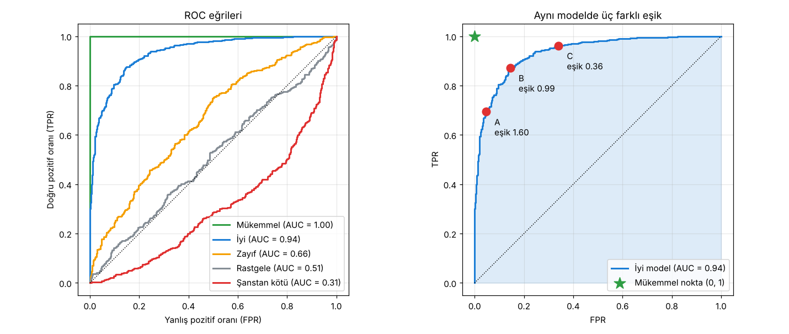

# 3.3 ROC ve AUC

> Kaynak: [ML Crash Course — Sınıflandırma: ROC ve AUC](https://developers.google.com/machine-learning/crash-course/classification/roc-and-auc?hl=tr)

Önceki dersteki metriklerin hepsi **tek bir eşikte** hesaplanıyordu. Modelin kalitesini **bütün eşiklerde birden** değerlendirmek için başka araçlar gerekir: **ROC** ve **AUC**.

## ROC eğrisi (Receiver Operating Characteristic)
**Tüm eşiklerde** model performansının görsel temsili. Adı ("alıcı çalışma karakteristiği") 2. Dünya Savaşı'ndaki **radar** algılamasından kalma.

**Nasıl çizilir?**
1. Her olası eşik için (pratikte belirli aralıklarla) **TPR** ve **FPR** hesaplanır.
2. **x ekseni = FPR**, **y ekseni = TPR** olacak şekilde noktalar birleştirilir.

| Eğri | Anlamı |
|---|---|
| (0,0) → (0,1) → (1,1), sol üst köşe | **Mükemmel model**: Bir eşikte TPR = 1, FPR = 0 |
| (0,0) → (1,1) köşegen | **Rastgele tahmin** (yazı-tura) |
| Köşegenin **altında** | **Şanstan kötü**: tahminler ters |

## AUC (Area Under the Curve, eğri altı alan)
ROC eğrisinin altındaki alan.

> 🎯 **AUC = Rastgele seçilen bir pozitif ve bir negatif örnek verildiğinde, modelin pozitife negatiften daha yüksek puan verme olasılığı.**

Bu olasılık **eşikten bağımsızdır**.

| AUC | Anlamı | Spam örneği |
|---|---|---|
| **1.0** | Mükemmel sıralama | Rastgele bir spam'e **her zaman** rastgele bir normal e-postadan yüksek spam olasılığı verir |
| **0.5** | Yazı-tura | Ancak **yarı yarıya** yüksek olasılık verir |
| **< 0.5** | Şanstan kötü | Çoğunlukla ters sıralar |

> 📝 AUC yalnızca **sıralamayı** ölçer. Bir e-postanın gerçekte spam olarak sınıflandırılıp sınıflandırılmayacağı yine seçilen **eşiğe** bağlıdır.

### Kodla doğrulama: AUC = sıralama olasılığı
AUC'yi iki ayrı yoldan hesapladım: (1) ROC eğrisinin altındaki alan (yamuk kuralı), (2) tüm pozitif–negatif çiftlerinde pozitifin daha yüksek puan alma oranı. **Birebir aynı** çıktı:

| Model | AUC (alan) | AUC (sıralama olasılığı) |
|---|---|---|
| Mükemmel | 1.000 | 1.000 |
| İyi | 0.936 | 0.936 |
| Zayıf | 0.660 | 0.660 |
| Rastgele | 0.509 | 0.509 |
| Şanstan kötü | 0.310 | 0.310 |

## AUC ve ROC ile model ve eşik seçimi

### Model seçimi
Veri kümesi **kabaca dengeli** olduğu sürece AUC, iki modeli karşılaştırmak için kullanışlıdır: **Alan ne kadar büyükse model o kadar iyi.** (Kurstaki örnek: AUC 0.93 olan model, 0.65 olandan iyi.)

### Eşik seçimi
ROC eğrisinde **(0, 1)'e en yakın** noktalar, o model için en iyi eşik aralığıdır. Ama hangi noktanın seçileceği **hataların maliyetine** bağlı. Sağdaki grafikte "iyi" model üzerinde üç eşik:

| Nokta | Eşik | FPR | TPR | Ne zaman seçilir? |
|---|---|---|---|---|
| **A** | 1.60 | 0.05 | 0.69 | **Yanlış alarm (FP) çok pahalıysa**: TPR düşse bile FPR'yi küçük tut |
| **B** | 0.99 | 0.14 | 0.87 | Maliyetler **yaklaşık eşitse**: TPR–FPR dengesi, (0,1)'e en yakın nokta |
| **C** | 0.36 | 0.34 | 0.96 | **FP ucuz, FN (kaçırılan pozitif) pahalıysa**: TPR'yi en üste çıkar |

> 💡 Eşik **yükseldikçe** ROC'de **sola-aşağı** (A'ya doğru), **düştükçe** **sağa-yukarı** (C'ye doğru) gidilir. (Buradaki eşikler olasılık değil ham puan olduğu için 1'den büyük olabiliyor.)

### (İsteğe bağlı) Kesinlik / geri çağırma eğrisi
Dengesiz veri kümelerinde ROC yerine **kesinlik–geri çağırma (PR) eğrisi** ve onun altındaki alan daha bilgilendirici olabilir.

## ✅ Kendimi test
**S1:** Gerçek hayatta ROC eğrileri zikzaklıdır. Hangisi en iyi: AUC **0.623**, **0.508**, **0.31**, **0.77**?
**C:** **AUC 0.77.** Yukarı, sonra sağa kıvrılan eğri; en yüksek AUC = en iyi performans.

**S2:** Hangisi **şanstan kötü**: AUC **0.5**, **0.32**, **0.508**, **1.0**?
**C:** **AUC 0.32.** Sağa, sonra yukarı kıvrılan eğri; 0.5'in altında. (0.5 ve 0.508 yaklaşık şans düzeyi, 1.0 mükemmel.)

**S3 (bonus):** Kritik bir iş e-postasını spam'e atmaktansa birkaç spam'in gelen kutusuna düşmesi daha iyi. Pozitif = spam. AUC = 0.84 olan eğride hangi nokta?
- A ≈ (0.25, 0.75), B ≈ (0.30, 0.90), C ≈ (0.40, 0.95)

**C:** **A noktası.** Burada FP (normal e-postayı spam saymak) pahalı, bu yüzden TPR biraz düşse de **FPR'yi en aza indiren** eşik seçilir.

## 🔑 Anahtar terimler
`ROC curve` · `AUC (area under the ROC curve)` · `TPR` · `FPR` · `threshold` · `precision-recall curve`

---
💻 İlgili kod: [`roc_auc.py`](../../kod/03-siniflandirma/roc_auc.py): ROC'u sıfırdan çizer, AUC'yi iki yoldan hesaplar, A/B/C eşiklerini bulur.
