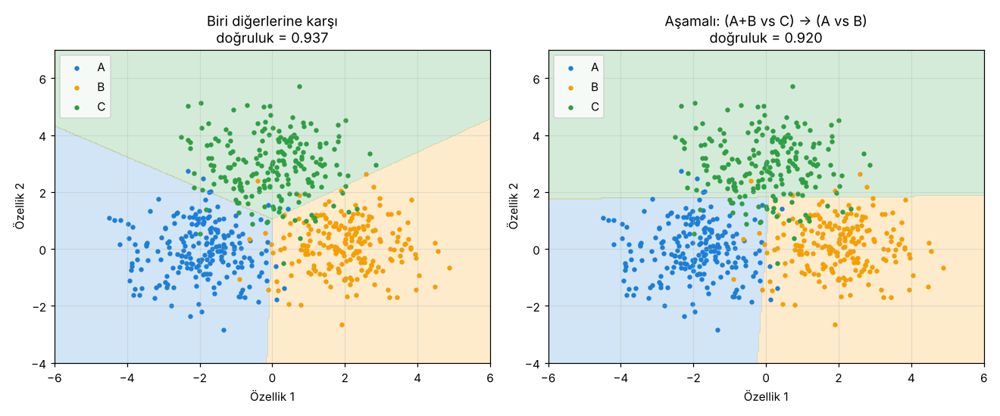

# 3.5 Çok Sınıflı Sınıflandırma

> Kaynak: [ML Crash Course — Sınıflandırma: Çok sınıflı sınıflandırma](https://developers.google.com/machine-learning/crash-course/classification/multiclass?hl=tr)

## Nedir?
**Çok sınıflı sınıflandırma (multi-class classification)**, ikili sınıflandırmanın **ikiden fazla sınıfa** genişletilmesidir.

**Örnek:** El yazısı bir rakamın resmine bakıp **0–9** arasından hangi rakam olduğuna karar veren sınıflandırıcı (10 sınıf).

## İkili sınıflandırıcılarla çözmek
Her örnek **yalnızca bir** sınıfa aitse, problem bir dizi **ikili** probleme bölünebilir:
- Bir taraf: **tek bir sınıf**
- Diğer taraf: **geri kalan bütün sınıflar** bir arada

Bu her sınıf için tekrarlanır.

### Dersteki örnek: A, B, C (aşamalı yaklaşım)
1. **1. ikili sınıflandırıcı:** Örnekleri **A+B** ve **C** olarak ayırır.
2. **2. ikili sınıflandırıcı:** A+B denen örnekleri **A** ve **B** olarak ayırır.

### Yaygın alternatif: biri diğerlerine karşı (one-vs-rest)
Her sınıf için ayrı bir "**bu sınıf mı, değil mi?**" sınıflandırıcısı eğitilir (A mı? B mi? C mi?). Örnek, olasılığı **en yüksek** çıkan sınıfa atanır.

## Deney: iki yaklaşım yan yana
İki özellikli, 3 sınıflı bir veride iki yaklaşımı da sıfırdan yazdığım mantıksal regresyonla denedim:

| Yaklaşım | İkili model sayısı | Test doğruluğu |
|---|---|---|
| Biri diğerlerine karşı | 3 (sınıf sayısı kadar) | **0.937** |
| Aşamalı: (A+B / C) → (A / B) | 2 | 0.920 |

**Karışıklık matrisi** artık 2×2 değil **3×3** (satır = tahmin, sütun = gerçek). Biri diğerlerine karşı yaklaşımda:

| | Gerçek A | Gerçek B | Gerçek C |
|---|---|---|---|
| **Tahmin A** | **192** | 5 | 9 |
| **Tahmin B** | 3 | **192** | 13 |
| **Tahmin C** | 5 | 3 | **178** |

Köşegen = doğru tahminler. En çok karışan sınıf C: 13 tanesi B, 9 tanesi A sanılmış.

**Gözlemler:**
- Aşamalı yaklaşımda karar sınırları **eksenlere paralel**, çünkü her aşama tek bir ayrım yapıyor. Ayrıca 1. aşamanın hatası 2. aşamaya taşınıyor: C'yi yanlışlıkla A+B diyen örnek, artık asla C olamıyor.
- Biri diğerlerine karşı yaklaşımda üç sınıflandırıcı **paralel** çalışıyor ve sınırlar daha doğal.

## Çok sınıflı ≠ çok etiketli
| | Çok sınıflı (multi-class) | Çok etiketli (multi-label) |
|---|---|---|
| Örnek başına sınıf | **Tam olarak bir** | **Birden fazla** olabilir |
| Örnek | Bu rakam 0–9'dan hangisi? | Bu fotoğrafta kedi **ve** köpek **ve** araba var mı? |

Çok sınıflı sınıflandırma, ileride **Nöral ağlar** modülünün "Çok sınıflı nöral ağlar" bölümünde (softmax ile) daha ayrıntılı işlenecek.

## 🔑 Anahtar terimler
`binary classification` · `multi-class classification` · `multi-label classification` · `one-vs-rest` · `confusion matrix`

---
💻 İlgili kod: [`cok_sinifli.py`](../../kod/03-siniflandirma/cok_sinifli.py): iki yaklaşımı sıfırdan uygular ve 3×3 karışıklık matrisini hesaplar.
