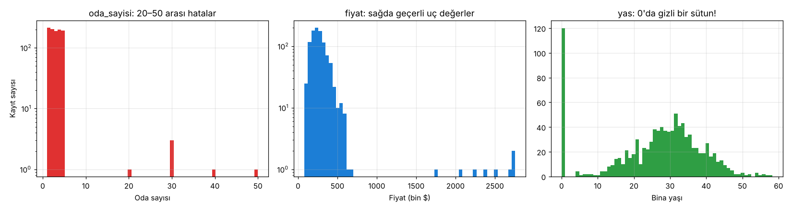

# 4.2 Sayısal Veri: İlk Adımlar

> Kaynak: [ML Crash Course — Sayısal veri: İlk adımlar](https://developers.google.com/machine-learning/crash-course/numerical-data/first-steps?hl=tr)

Özellik vektörlerini oluşturmadan **önce** sayısal veriyi iki şekilde incele:
1. **Görselleştir:** dağılım grafiği, histogram
2. **İstatistiklerini çıkar**

## 1) Görselleştirme
Grafikler, verideki gizli **anormallikleri ve kalıpları** ortaya çıkarır.
- Analize dalmadan önce verine **dağılım grafiği** ya da **histogram** olarak bak.
- Bunu sadece başta değil, **her dönüşümden sonra** da yap. Görselleştirme varsayımlarını sürekli kontrol etmeni sağlar.
- Önerilen araç: **pandas** ([eksik verilerle çalışma](http://pandas.pydata.org/pandas-docs/stable/missing_data.html), [görselleştirme](http://pandas.pydata.org/pandas-docs/stable/visualization.html)).
- Her araç her veri biçimine uygun değildir: protokol arabellekleri (protobuf) için iyi olan bir araç CSV için iyi olmayabilir.

## 2) İstatistikler
Olası özellikler ve etiketler için şu temel istatistikleri topla:
- **Ortalama** ve **medyan**
- **Standart sapma**
- **Çeyrek yüzdelikler:** 0. (min), 25., 50. (medyan), 75., 100. (max)

pandas'ta hepsi tek satır: `df.describe()`

## Aykırı değerler (outliers)
**Aykırı değer:** Bir özellik ya da etiketteki diğer değerlerin çoğundan **uzak** olan değer. Model eğitiminde genellikle sorun çıkarır, bu yüzden bulmak önemli.

> 📝 Türkçe sayfada aynı kavram için "aykırı değer", "ayrık değer", "tekil değer" ve anahtar terimlerde "dikkat çeken içerikler" geçiyor. Hepsi *outliers*.

### Hızlı kontrol: yüzdelik farkları
**(25. − 0.) yüzdelik farkı**, **(100. − 75.) farkından çok farklıysa** veri kümesinde muhtemelen aykırı değer vardır.

⚠️ Ama temel istatistiklere **fazla güvenme**: Anormallikler, dengeli görünen verilerde de saklanabilir.

## Deney: üç tür sorun
Üç sütunlu, 1.000 satırlık sentetik bir "ev" verisi ürettim; her sütuna farklı türde bir sorun koydum:

| Sütun | Gizlenen sorun |
|---|---|
| `oda_sayisi` | **Hata:** 6 kayıtta fazladan sıfır girilmiş (3 → 30) |
| `fiyat` | **Geçerli uç değer:** 8 gerçek lüks ev |
| `yas` | **Gizli anormallik:** "bilinmiyor" değerleri **0** diye kaydedilmiş (%12) |

### `describe()` ne diyor?
| | oda_sayisi | fiyat | yas |
|---|---|---|---|
| ortalama | 3.1 | 283.0 | 26.4 |
| std | 2.8 | 214.4 | 12.9 |
| min (0.) | 1.0 | 79.5 | 0.0 |
| 25. | 2.0 | 194.7 | 20.4 |
| 50. (medyan) | 3.0 | 252.4 | 28.8 |
| 75. | 4.0 | 319.4 | 34.7 |
| max (100.) | **50.0** | **2758.3** | 58.3 |

### Yüzdelik farkı kontrolü
| Sütun | 0→25 | 75→100 | Oran | Sonuç |
|---|---|---|---|---|
| oda_sayisi | 1.0 | 46.0 | 46× | ⚠️ aykırı değer var |
| fiyat | 115.2 | 2438.8 | 21× | ⚠️ aykırı değer var |
| yas | 20.4 | 23.6 | 1.2× | ✓ temiz **görünüyor**… |

### Histogramlar gerçeği gösteriyor

`yas` sütunu istatistiklerde gayet dengeli görünüyordu, ama histogramda **0'da 120 kayıtlık bir sütun** var. Bunlar eksik veriler. Bu yüzden ortalama yaş 30.0 yerine **26.4** çıkıyordu. Dersteki uyarının canlı örneği: **Sadece istatistiklere bakma, mutlaka görselleştir.**

## Aykırı değerle ne yapmalı?
| Durum | Ne yapılır? | Deneydeki karşılığı |
|---|---|---|
| **Hata** (fazladan sıfır, bozuk cihaz) | Genellikle o örnekleri **sil** | 6 hatalı `oda_sayisi` satırı silindi |
| **Geçerli veri** ve model bu uç durumlar için **iyi tahmin yapmalı** | Eğitim verisinde **tut**. Özellikteki aykırı değerler bazen etiketteki aykırı değerleri açıklar. Ama **aşırı** uç değerler yine de zarar verebilir. | Lüks evlerin fiyatını tahmin etmek istiyorsak tut |
| **Geçerli veri** ama model bunlar için tahmin yapmak zorunda değil | **Sil** ya da **kırpma (clipping)** gibi daha müdahaleci bir teknik uygula | Fiyat 99. yüzdelikte (599) kırpıldı: max 2758 → 599 |

**Kırpma (clipping):** Belirli bir sınırın üstündeki (ya da altındaki) değerleri o sınıra eşitlemek. Ayrıntıları normalleştirme dersinde.

## 🔑 Anahtar terimler
`outlier` · `clipping` · `percentile` · `median` · `standard deviation` · `histogram`

---
💻 İlgili kod: [`ilk_adimlar.py`](../../kod/04-sayisal-veri/ilk_adimlar.py)
