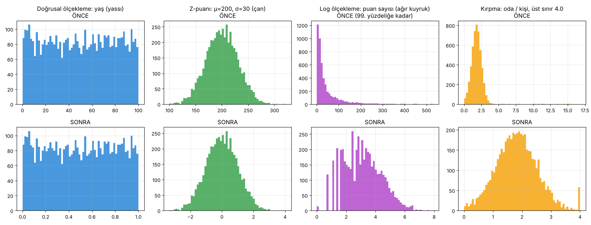

# 4.4 Normalleştirme

> Kaynak: [ML Crash Course — Sayısal veri: Normalleştirme](https://developers.google.com/machine-learning/crash-course/numerical-data/normalization?hl=tr)

Veriyi inceledikten sonra, modelin daha etkili eğitilmesi için onu **dönüştürmek** gerekir.

🎯 **Normalleştirmenin amacı:** Özellikleri **benzer bir ölçeğe** getirmek.

Örnek: X özelliği **154 ile 24.917.482** arasında, Y özelliği **5 ile 22** arasında. Normalleştirme ikisini de benzer bir aralığa (ör. 0–1) çeker.

## Neden normalleştirmeli?
1. **Daha hızlı yakınsama:** Aralıklar çok farklıysa gradyan inişi **seker** ve yavaşlar. (Adagrad, Adam gibi gelişmiş optimizer'lar öğrenme oranını uyarlayarak bunu kısmen önler.)
2. **Daha iyi tahminler**
3. **"NaN tuzağından" kaçınma:** Değerler çok büyükse kayan nokta sınırı aşılır, sayı **NaN** olur. Modelde bir NaN çıkınca zamanla **bütün sayılar** NaN'a döner.
4. **Doğru ağırlıklar:** Ölçekleme yoksa model geniş aralıklı özelliklere **fazla**, dar aralıklılara **az** dikkat eder.

**Ne zaman?** Aralıkları belirgin şekilde farklı özellikler varsa (ör. **yaş** ve **gelir**), ya da tek bir özellik çok geniş bir aralığa yayılıyorsa (ör. **şehir nüfusu**).

> ⚠️ **Eğitimde normalleştirdiğin özelliği tahmin yaparken de aynı şekilde normalleştirmelisin.** (Eğitim verisinin min/max veya μ/σ değerleri saklanıp tahminde de onlar kullanılır.)

### Aralık farkı ne kadar önemli?
| Özellikler | Fark | Normalleştirmezsen |
|---|---|---|
| A ∈ [−0.5, 0.5], B ∈ [−5, 5] | 10× | Model başta B'yi 10 kat "önemli" sanır, eğitim uzar, model optimum olmayabilir. Hasar **küçük**, ama yine de ikisini aynı ölçeğe (ör. −1…+1) getir. |
| C ∈ [−1, 1], D ∈ [5.000, 1.000.000.000] | ~10⁹× | Model büyük olasılıkla iyi çalışmaz; yakınsama **çok uzun sürer ya da hiç olmaz**. |

### Deney: C ve D ile gradyan inişi
| Durum | Sonuç |
|---|---|
| Ham özellikler, lr = 0.1 | **10. adımda NaN / sonsuz** 💥 (NaN tuzağı) |
| Ham özellikler, lr = 10⁻¹⁹ (patlamasın diye) | MSE = 3.26: adımlar o kadar küçük ki **hiç öğrenemiyor** |
| **Z-puanıyla normalleştirilmiş**, lr = 0.1 | **MSE = 0.01** ✅ |

Aynı veri, aynı model; tek fark normalleştirme.

## Dört teknik

### 1) Doğrusal ölçekleme (linear scaling)
Değerleri doğal aralığından standart bir aralığa (genelde **0–1** ya da **−1…+1**) taşır:

$$x' = \frac{x - x_{min}}{x_{max} - x_{min}}$$

**Şu koşulların hepsi** sağlanıyorsa iyi bir seçim:
- Alt ve üst sınırlar zamanla **pek değişmiyor**
- Aykırı değer **az ya da hiç yok**, olanlar da aşırı değil
- Değerler aralığa **yaklaşık eşit** dağılmış (**yassı** histogram)

**Örnek: yaş (`age`)** → ✅ Sınırlar ~0–100, aykırı değer az (nüfusun sadece %0.3'ü 100 yaş üstü), her yaştan yeterli örnek var.

> 📝 Gerçek dünyadaki çoğu özellik bu koşulların hepsini sağlamaz; **z-puanı genelde daha iyi** bir seçimdir.

**Alıştırma: `net_worth` (net servet) için doğrusal ölçekleme iyi mi?**
**Hayır.** Birkaç milyarder aralığı devasa yapar. Deneyde kişilerin **%99.9'u 0.001'in altına** sıkıştı; model aralarındaki farkı neredeyse göremez.

### 2) Z-puanı ölçekleme (z-score scaling)
**Z-puanı** = bir değerin ortalamadan kaç **standart sapma** uzakta olduğu. (Ortalamadan 2σ büyük → +2.0; 1.5σ küçük → −1.5.)

$$x' = \frac{x - \mu}{\sigma}$$

Sonuç: ortalama **0**, standart sapma **1**. Deneyde μ = 200, σ = 30 olan veri → μ = 0.00, σ = 1.00.

- Veri **normal** (çan şeklinde) ya da **normale benzer** dağılıyorsa iyi bir seçim.
- Dağılımın çoğu normal ama birkaç **aşırı uç değer** varsa (ör. `net_worth`): **z-puanı + kırpma** birlikte kullanılır.

**Alıştırma: 10 milyon yetişkin kadının boyu (`height`) için z-puanı iyi mi?**
**Evet.** Boy normal dağılıma uyar; çok az değer ortalamadan 3σ'dan fazla uzaktadır.

### 3) Log ölçekleme (log scaling)
Ham değerin **logaritmasını** alır (pratikte genelde doğal logaritma, ln):

$$x' = \ln(x)$$

**Güç yasası (power law)** dağılımında işe yarar: Küçük X değerlerine çok yüksek Y değerleri karşılık gelir, X arttıkça Y hızla düşer (**ağır kuyruk**).

**Örnekler:**
- **Film puanları:** Birkaç film çok sayıda puan alır, çoğu filmin puan sayısı çok azdır.
- **Kitap satışları:** Çoğu kitap 100–200, bazıları binlerce, çok azı milyonlarca satar.
  - ln(100) ≈ **4.6**, ln(1.000.000) ≈ **13.8**
  - Ham değerlerde **10.000 kat** olan fark, log ölçekte sadece **~3 kata** iner. Model için öğrenmesi çok daha kolay.

> 📝 Kurstaki şeklin altyazısında "günlüğüyle karşılaştırma" yazıyor; doğrusu "**logaritmasıyla** karşılaştırma" (*log* ≠ günlük).

### 4) Kırpma (clipping)
Tam olarak bir normalleştirme tekniği değil, ama aşırı uç değerlerin etkisini azaltır. Belirli bir sınırın üstündeki değerleri **o sınıra eşitler**.

**Örnek: `roomsPerPerson`** (kişi başına oda): Değerlerin %99'dan fazlası normal dağılıyor (μ ≈ 1.8, σ ≈ 0.7), ama kuyruk **17'ye** kadar uzanıyor. **4.0'da kırpınca:**
- 4.0'dan büyük değerler **silinmez, 4.0 olur**. Histogramda 4.0'da **tuhaf bir tepe** bunun için oluşur (deneyde 54 değer).
- Yine de kırpılmış özellik orijinalinden **daha kullanışlıdır**.
- "Her aykırı değeri keyfi bir sınıra çekebilir miyim?" → **Model eğitirken evet.**

Diğer normalleştirmelerden **sonra** da kırpılabilir: Ör. z-puanında **> 3 → 3**, **< −3 → −3**. (Deneyde z aralığı [−1.6, 13.0] → [−1.6, 3.0].)

⚠️ Kırpma, modelin önemsiz verilere fazla odaklanmasını önler, ama **bazı aykırı değerler önemlidir**. Dikkatli kırp.

## Özet
| Teknik | Formül | Ne zaman? | Histogram şekli |
|---|---|---|---|
| **Doğrusal ölçekleme** | (x − min) / (max − min) | Aralığa yaklaşık eşit dağılmışsa | Yassı |
| **Z-puanı** | (x − μ) / σ | Normal dağılımsa (tepe ortalamaya yakın) | Çan |
| **Log ölçekleme** | ln(x) | En az bir tarafta yoğun çarpıklık varsa | Ağır kuyruk |
| **Kırpma** | x > max → max; x < min → min | Aşırı aykırı değerler varsa | Uzun, seyrek kuyruk |

> 💡 **En iyi teknik, pratikte iyi çalışan tekniktir.** Dağılımına uyacağını düşündüğün yeni fikirleri denemekten çekinme.

## ✅ Kendimi test
**S1:** 0–200.000 arası değerler; sayı 0'dan 100.000'e **kademeli artıyor**, sonra 200.000'e **kademeli azalıyor**. En uygun teknik?
**C:** **Z-puanı ölçekleme.** Tepesi ortada, iki yana azalan bir dağılım; normal dağılıma benziyor.

**S2:** Veri merkezi verimliliğini **sıcaklıktan** tahmin eden model. Sıcaklıkların neredeyse hepsi 15–30 °C, ama:
- Yılda bir-iki aşırı sıcak günde **31–45** arası değerler var
- Her **1.000.** kayıt gerçek sıcaklık yerine **1.000** olarak ayarlanmış

**C:** **31–45 arasındaki aykırı değerleri kırp, 1.000 olanları sil.**
- 31–45 **gerçek** ölçümler (sıcak günler) → bilgi taşıdıkları için silinmez, kırpılır.
- 1.000 bir **hata** (fiziksel olarak imkânsız) → silinir.

Kodda: 10 hatalı satır silindi, 40 sıcak gün 30'da kırpıldı → aralık [15, 30].

## 🔑 Anahtar terimler
`normalization` · `scaling` · `linear scaling` · `Z-score normalization` · `log scaling` · `clipping` · `NaN trap` · `power law`

---
💻 İlgili kod: [`normallestirme.py`](../../kod/04-sayisal-veri/normallestirme.py)
